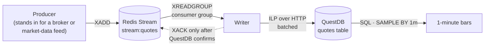
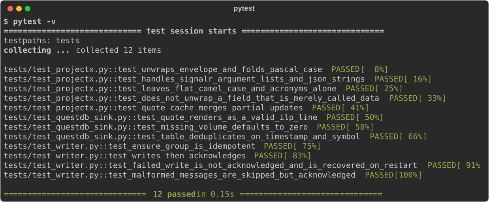
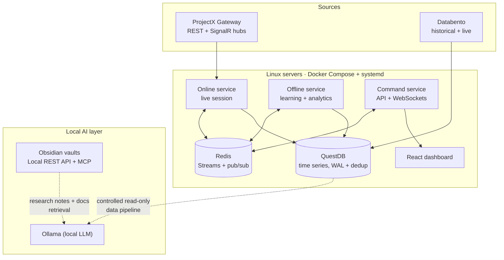

# QuantTrader: real-time trading data architecture


**How a small team moves live market data from broker and data-vendor APIs into a time-series database reliably, and a runnable reference version you can start with one command.**

QuantTrader is a private trading-research platform I've built with a business partner. The trading logic is proprietary and stays private. This repository shares the part that isn't: **the data plumbing**. It has a reference implementation of the core pattern, the real-world API lessons behind it, and an architecture overview of the full system.

---

## Run it in one command

You need **Docker Desktop** ([download](https://www.docker.com/products/docker-desktop/)). Start it, then:

```bash
git clone https://github.com/nomaan02/quanttrader-architecture.git
cd quanttrader-architecture
cp .env.example .env          # Windows PowerShell: copy .env.example .env
docker compose up --build
```

**You should see:** four services start (`redis`, `questdb`, `producer`, `writer`). After about 20 seconds the logs show `producer … quotes published` and `writer … consumer writer-1 reading stream:quotes`.

Then, in a second terminal:

```bash
pip install -r requirements.txt
python scripts/query_bars.py
```

**You should see:** a table of 1-minute open/high/low/close bars for `DEMO.A` and `DEMO.B`, growing every minute. You can also open the QuestDB console at **http://localhost:9000** and run `SELECT * FROM quotes LIMIT 20;`.

**Try the crash test:** stop the writer with `docker compose stop writer`, wait a minute, then run `docker compose start writer`. The log says `recovering N unacknowledged message(s)` or simply catches up, and the bars have **no gap**. That's the point of the design.

To stop everything: **Ctrl + C**, then `docker compose down`. Add `-v` to also delete the stored data.

> The prices are a **synthetic random walk**. No real market data, broker account or API key is used.

---

## The reference pipeline



| Piece | File | What it shows |
|---|---|---|
| Hub message normaliser | [`shared/projectx.py`](shared/projectx.py) | Turning a real broker hub's messages (envelope, mixed key casing, partial updates) into one clean shape |
| Stream helpers | [`shared/streams.py`](shared/streams.py) | Durable messaging with consumer groups, capped stream length and crash recovery |
| QuestDB sink | [`shared/questdb_sink.py`](shared/questdb_sink.py) | Batched writes over HTTP, and a table that de-duplicates replayed rows |
| Producer | [`services/producer.py`](services/producer.py) | Emits hub-shaped quote updates and publishes complete quotes |
| Writer | [`services/writer.py`](services/writer.py) | Recover → read → write → acknowledge, in that order |
| Bar query | [`scripts/query_bars.py`](scripts/query_bars.py) | Time-series SQL (`SAMPLE BY`) through QuestDB's REST API |

### The design decisions

- **Acknowledge after the database confirms, never before.** If the writer crashes mid-batch, Redis still holds those messages as *pending*. On restart, the writer processes its pending list before reading anything new.
- **Make replays harmless.** Recovery means a row can be written twice. The table is declared with `DEDUP UPSERT KEYS(ts, symbol)`, so QuestDB merges duplicates instead of storing them.
- **Streams, not pub/sub, for anything that matters.** Pub/sub drops a message if the listener is restarting at that moment. Streams keep it until it's acknowledged.
- **Cap everything.** Streams are trimmed to about 10,000 entries, so a stalled consumer can't fill the server's memory.
- **Pin infrastructure versions.** QuestDB is pinned by image digest, because a major upgrade can change the on-disk format. Upgrading is a deliberate, backed-up step.
- **Nothing exposed by default.** Every port binds to `127.0.0.1`, and Redis needs a password.

### Tests

```bash
pip install -r requirements-dev.txt
pytest -v
```



The tests cover the hub-message quirks, the exact line-protocol output, and the crash scenario: a failed database write leaves the message pending, and a restarted writer recovers it.

---

## Lessons from the real APIs

These came up while integrating the production system, and they're the reason the reference code looks the way it does.

**ProjectX Gateway (the TopstepX broker API): REST + SignalR WebSockets**
- Real-time events come from two SignalR hubs: a **market hub** (quotes, trades, depth) and a **user hub** (account, orders, positions, fills).
- User-hub events arrive wrapped as `{"data": {...}, "action": 0|1|2}` (create / update / delete), and keys may be `PascalCase` or `camelCase`. `normalize_hub_payload()` handles both, plus SignalR's habit of sending a list or a JSON string.
- Quote updates contain **only the fields that changed**, so a quote cache merges each update onto the last known quote.
- Session tokens last about 24 hours. The live client reconnects with a fresh token every 20 hours, and re-subscribes to every contract on every reconnect.

**Databento (market-data vendor): historical + live**
- The historical API for CME futures can't serve the most recent ~20 minutes, so "live" data from a historical poller is really delayed. Real-time needs the separate **Live** streaming client.
- Running both historical backfill and the live stream means **two writers to the same table**. Identical row shapes plus QuestDB de-duplication keys make them converge safely, the same idea as the replay protection above.
- **Honest nulls:** if a dataset isn't licensed for live use, the producer skips it and says so. It never backfills delayed data and labels it "live".

---

## The full platform (private)



- **Separate services that only talk through Redis.** The live-session, offline-analytics and command/API services each have their own consumer groups, so any one can restart without losing messages.
- **One time-series store.** Market data, signals and outcomes all land in QuestDB, queried over its PostgreSQL wire protocol and REST API.
- **Deployed on Linux** with Docker Compose and systemd units, with health checks, restart limits and localhost-only ports.
- **A local LLM layer.** Ollama runs on our own hardware, reads platform data through a controlled pipeline, and retrieves over our documentation. Research notes live in Obsidian vaults, connected through the Obsidian Local REST API and MCP, so AI agents can work with them directly.

**Not in this repository, on purpose:** trading strategies, signal logic, models, parameters, results, account details and infrastructure addresses.

## How I used AI to build this

The production system is built with AI coding agents (Claude Code and Cursor), under rules we wrote first:

- **Spec before code.** Larger changes are written up as *work packages*, each with a spec, an audit of the current state, results and a rollback plan. The agent implements; we review.
- **Hard rules written down.** Instruction files and code comments set out what an agent must never do. For example: never fabricate or back-date data, and never move the database to a new image version without a backup.
- **Regression tests for live issues.** Problems found in live sessions, such as unexpected hub message shapes or recovering unacknowledged messages, got their own tests. The tests in this repo follow the same pattern.

This reference repo was extracted with the help of Claude Code, then checked by running the pipeline and tests.

## Licence

[MIT](LICENSE)
